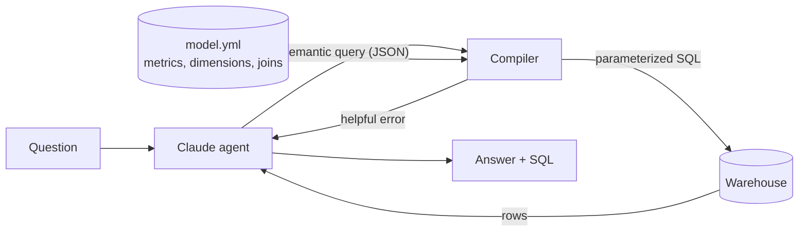

# Talk to Your Warehouse

Ask a data warehouse questions in plain English, and get answers that use your company's official metric definitions, with an eval suite that proves how often the answers are right.

A Propri project.

```
$ python -m ttw ask --show-sql "Which categories had more than $500k in revenue in 2025?"
Electronics ($1.12M) and Home ($585K) both cleared $500K in 2025.
Revenue here is net of discounts and counts completed orders only.

--- SQL ---
SELECT
  p.category AS "category",
  SUM(oi.quantity * oi.unit_price * (1 - oi.discount)) AS "revenue"
FROM order_items AS oi
JOIN orders AS o ON o.order_id = oi.order_id
JOIN products AS p ON p.product_id = oi.product_id
WHERE o.status = 'completed'
  AND o.order_date BETWEEN CAST('2025-01-01' AS DATE) AND CAST('2025-12-31' AS DATE)
GROUP BY 1
HAVING SUM(oi.quantity * oi.unit_price * (1 - oi.discount)) > 500000
```

<sub>The SQL and figures are real output from the compiler on the bundled data; the answer wording is illustrative of what the model writes.</sub>

## Why a semantic layer

Plain text-to-SQL demos well and fails quietly in production. Ask "what was revenue last year?" and an LLM writing raw SQL will often sum every order, including cancelled and returned ones, and return a confident, wrong number. Nobody notices, because the answer looks plausible.

This project puts a **semantic layer** between the model and the warehouse:

- **The model chooses; the compiler writes.** Claude picks metrics, dimensions and filters from a governed catalog. A deterministic compiler turns that choice into SQL. The model cannot invent a definition of revenue.
- **Definitions live in one YAML file.** `semantic/model.yml` says that revenue is net of discounts and counts completed orders only. Change it once and every answer follows.
- **Accuracy is measured, not asserted.** 22 questions with hand-written gold SQL, scored by comparing result sets. The same harness runs a raw-SQL baseline so you can show a client the difference on their own data.



## Quickstart

```bash
pip install -r requirements.txt
python -m ttw generate                         # builds data/warehouse.duckdb (~1s)
python -m ttw eval                             # oracle eval, no API key needed
pytest -q                                      # 29 tests, no API key needed

export ANTHROPIC_API_KEY=sk-ant-...
python -m ttw ask "What was the return rate by category?"
python -m ttw ask --baseline "What was the return rate by category?"   # raw-SQL agent
python -m ttw eval --modes oracle semantic sql                          # full comparison
```

The default model is `claude-sonnet-5-5`. Override with `--model` or `TTW_MODEL`.

## What's in the box

| Path | What it does |
|---|---|
| `ttw/generate.py` | Deterministic synthetic e-commerce warehouse: 3,000 customers, 40 products, ~26K orders, ~45K line items over 2024–2025. Includes growth, Q4 seasonality, a 2025 price increase, holiday discounting, a shift toward mobile, and higher apparel return rates, so there are real patterns to find. |
| `semantic/model.yml` | The semantic model: 12 metrics (4 derived), 9 dimensions with time grains, join graph, synonyms. |
| `ttw/semantic.py` | The compiler. Validates queries, expands derived metrics, prunes joins, pushes filters down, binds parameters. |
| `ttw/agent.py` | `SemanticAgent` (the product) and `SQLAgent` (the baseline), sharing one Claude tool-use loop. |
| `ttw/evaluation.py` | Execution-based scorer and Markdown/JSONL report writer. |
| `evals/questions.yml` | 22 questions with gold SQL, the reference semantic query, and tags. |
| `tests/test_ttw.py` | Compiler, scorer, and agent-loop tests. The agent tests use a scripted fake client, so they run offline. |

## Design decisions

**One fact table at line-item grain.** Every metric is aggregated from `order_items`, so joining to orders, products and customers never duplicates rows. Order-level counts use `COUNT(DISTINCT o.order_id)`. This is the most common source of silent errors in hand-written analytics SQL, and the layer rules it out by construction.

**Metric filters are part of the metric.** Revenue carries `filter: o.status = 'completed'`. When every metric in a query shares a filter, the compiler pushes it into `WHERE`. When they differ (revenue alongside return rate), it uses `SUM(CASE WHEN ... THEN ... END)` per metric so both are correct in one query.

**Derived metrics compose.** `gross_margin: "{gross_profit} / NULLIF({revenue}, 0)"` expands recursively. Cycles and dangling references are rejected when the model loads.

**Joins are pruned.** `order_count` alone touches two tables; add `region` and the compiler adds `customers`, through `orders`, because the model declares `via: orders`.

**Errors are written for the model.** Unknown names come back with "Did you mean: revenue?". Bad date filters ask for ISO dates. The agent reads the error and retries, which the tests exercise.

**The tool schema constrains the model.** Metric and dimension names are JSON-schema enums, so most invalid choices are blocked before they reach the compiler. Low-cardinality dimension values (regions, segments, channels) go in the system prompt. A `get_dimension_values` tool covers the rest, such as product names.

**User values are never spliced into SQL.** Filter values are bound parameters. `rendered()` inlines them only for display.

**Scoring compares results, not SQL text.** Many correct queries exist for one question. The scorer ignores column names and order, allows extra columns, compares numbers at 6 significant digits, and enforces row order only where the question implies it. `top_n` questions check that the first N rows match.

## The eval

```
python -m ttw eval --modes oracle semantic sql
```

Each run writes `evals/results/eval-<timestamp>.md` (summary, accuracy by tag, per-question grid, and every failure with its SQL and answer) and a `.jsonl` with full records.

- **oracle** compiles each question's reference semantic query. It currently scores **22/22**, which proves the layer can express every question and that the compiler matches independently written SQL.
- **semantic** is Claude using the semantic layer.
- **sql** is Claude writing raw SQL against the schema. Its prompt includes the schema and the valid status and channel values, but not the business definitions. That gap is the point of the comparison. To isolate how much comes from documentation alone, paste the metric definitions into `SQLAgent.system_prompt` and rerun.

Tags (`business_rule`, `derived`, `ranking`, `having`, `cohort`, `time_series`, ...) break accuracy down so you can see where each approach fails. Expect the gap to show up mostly in `business_rule` questions.

Use `--fail-under 0.9` to make CI fail when accuracy drops. That turns the eval into a regression test for prompt changes, model upgrades, and edits to `model.yml`.

## Adapting it to a client

1. **Point it at their warehouse.** Swap the DuckDB connection for Snowflake, BigQuery or Databricks. The compiler emits standard SQL plus `date_trunc` and `CAST(... AS DATE)`, which all three support. BigQuery's `DATE_TRUNC(date, MONTH)` argument order differs, so add a small dialect hook in `_dimension_sql` if you target it.
2. **Write their `model.yml`.** Start from the 10–20 metrics their exec dashboards already report. The disagreements you uncover while writing definitions are often the most valuable output of the engagement.
3. **Build their eval set from real questions.** Pull 30–50 from Slack threads and analyst ticket queues, and have their analysts write the gold SQL. Questions the catalog can't answer show you what to add next.
4. **Run the baseline comparison on their data.** It makes the case for the engagement in their own numbers.
5. **If they already use dbt or Cube**, translate their existing metric definitions into this format, or replace `semantic.py` with calls to their semantic layer's API and keep the agent and eval harness.

## Natural next steps

- Unanswerable-question evals: check that the agent says "the catalog can't answer that" instead of improvising.
- Multi-turn follow-ups ("now break that down by month").
- Row-level access policies applied in the compiler, per user.
- A small chat UI with the generated SQL shown next to each answer.
- Repeated runs per question to measure variance, not just one-shot accuracy.
